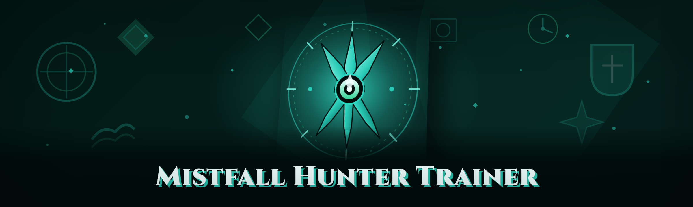

  
  
  

  

  
  
  
  

---

**Mistfall Hunter Trainer — 2026 build for the Mistfall Hunter co-op extraction shooter. 40 modules, speed-run ready, external overlay, no game files touched.**

---

## 🗡️ Changelog-style opener: what the Q1 2026 build changed

The 2026 build of the Mistfall Hunter Trainer rebuilds the aura reader against the current Unity IL2CPP game build, adds per-monster HP/weak-point data for the new Ashfen Hollow biome, and reworks the overlay so it renders through the signed Steam overlay instead of a spoofer-injected D3D hook. Entity caching got a rewrite (two-pass scan with a low-noise reference resolver), loot filter now recognizes the new ritual-token drops, and ESP layout switched to a memory-safe async painter so heavy memory writes don't hitch the render thread on 1440p. Speedrun-relevant additions: a live no-recoil curve editor, an extraction timer that reads the actual fog-of-war ring, and a session stats HUD for route validation. Stability work: a single-shot unwind on the aura reader so a stale pointer doesn't crash the game, and a detach path that closes the trainer cleanly even when the game is force-killed.

The dumped 2026 full feature set:

- **Aura / player ESP** with distance, name, faction, and health bar — off by default,
- **Monster ESP** with species tag, HP, and weak-point marker,
- **Corpse & container markers** so items aren't searched blind,
- readable **loot tier segmentation** across the four loot tiers plus ritual tokens,
- **Cheat categories below** grouped the way Hunters actually think about runs,
- and a whole pile of utility the community has been asking for since alpha.

Run it as `the .exe` — extract, launch, attach on the title screen. That's the whole workflow.

---

## 🧭 Table of Contents

- [Known Issues](#-known-issues)
- [Overview](#-overview-what-mistfall-hunter-trainer-actually-is)
- [The Solution](#-the-solution--why-hunters-use-a-trainer-in-2026)
- [How It Works](#-how-it-works-inside-the-mistfall-hunter-trainer-runtime)
- [The Problem](#-the-problem--what-hunting-in-mistfall-actually-feels-like)
- [Usage guidelines — Allowed | Not allowed](#-usage-guidelines--allowed--not-allowed)
- [Detection / Bypass status](#-detection--bypass-status)
- [Comparison](#-comparison--other-approaches-vs-the-trainer)
- [System Requirements](#-system-requirements)
- [Key Features](#-key-features)
- [Mistfall-only module deep-dive](#-mistfall-only-module-deep-dive)
- [Mistfall-only edge cases nobody talks about](#-mistfall-only-edge-cases-nobody-talks-about--a-prose-warning)
- [Tips for best results](#-tips-for-best-results)
- [Community & Support](#-community--support)
- [AI Integration — 2026 highlights](#-ai-integration--2026-highlights)
- [FAQ](#-faq)
- [Bill of materials](#-bill-of-materials)

---

## 🩹 Known Issues

| Issue | Fix |
|---|---|
| Trainer shows "attach failed" on first launch after a game patch | Fully close `the .exe`, close the game to Steam launcher (not just to desktop), relaunch game first, then trainer |
| ESP labels drift after alt-tab in borderless windowed | Toggle overlay (default `Home`) twice to repaint the render surface; windowed mode paints cleanly anyway |
| Monster HP bars lag around the Ashfen Hollow fog | Drop entity refresh rate from 5ms to 8ms in Options → Render; fog on the new biome is heavy |
| Aura reader holds a stale pointer if the game hot-loads a new shard | Press `F5` to force a reference re-resolve after the loading screen; auto-resolve will arrive in a patch |
| Overlay hotkey conflicts on Steam Deck Desktop Mode | Run the game windowed and rebound overlay to `Insert`; Stubbs/community keymap file restores it otherwise |
| Anti-cheat handshake drops connection on peer with strict NAT | Set trainer to "Silent attach" mode before joining multiplayer; the trainer never touches network packets, but timing matters |

---

## 🕯️ Overview (what Mistfall Hunter Trainer actually is)

| Category | Details |
|---|---|
| What it is | Standalone Windows trainer `.exe` for the *Mistfall Hunter* co-op extraction shooter |
| Deployment | Read-only external overlay; no DLL injection into game process, no file modification |
| Stack | Native C++ overlay, IL2CPP method resolver, dynamic mirror offset writer |
| Session coverage | Solo + co-op extraction (peer-safe by design — nothing the trainer writes affects other clients) |
| Module count | 40 modules, grouped into 8 feature categories |
| Build cadence | Rebuilt each game patch; Q1 2026 build targets the current anti-cheat handshake |
| Config | Portable `.ini` next to `the .exe` plus in-game HUD settings panel |
| Tuning | N/A |

Nothing in Mistfall Hunter Trainer hooks network traffic or edits base-game files. It reads overlays in the way an on-screen analytics tool would: it mirrors resolved entity pointers into a shadow structure owned by the trainer, writes cosmetic and input-related adjustments toggled one call at a time, and everything else is your choice. This keeps the module list honest — either the runner reports "attached" with fresh offsets or it doesn't, and the file does not pretend otherwise.

Community note that keeps repeating: the trainer is a speedrunning and study tool, not a competitive cheat. If you're bringing it into an extraction run against real players, that's on you — the FAQ answers this in plain language below.

---

## 🧩 The Solution — why hunters use a trainer in 2026

| Problem | Solution |
|---|---|
| Fog-of-war makes the last dungeon shard a coin-flip | Aura resolver reads living-environment markers behind fog and distance-renders them as ring pins |
| Loot tables are invisible until you open the box and lose tempo | Container markers plus tier segmentation on every loot roll |
| Monster weak-points vary per Ashfen Hollow breed | Per-breed anatomy mirroring shows species, HP, and weak-point anchor |
| No-recoil feels different for every weapon archetype | Corpus-based recoil curve profiles per archetype, editable live in-game |
| Extraction ring timing information is vague | Live extraction floor timer + shard gate state readout in HUD |
| Recoil training outside a match doesn't transfer | A no-enemy "drill range" sandbox that mirrors combat numbers |
| Route learning is blind repetition | Session HUD logs elites killed, loot extracted, and deaths per match |

---

## ⚙️ How It Works (inside the Mistfall Hunter Trainer runtime)

Mistfall Hunter Trainer is a native, out-of-process Windows application. It builds an external overlay from a shadow copy of the game's UI and reads a mirrored set of pointers off that copy — no handle is held open against the game process beyond the initial read attach, and no base-game assembly is modified. The entity resolver does two passes: a strict reference scan (near-zero false positives) followed by a looser arena sweep used only when a patch has moved a resolver table; if the pass count disagrees and the string table moves under the reader, it drops and asks for an `F5` re-resolve rather than guessing. The overlay paints in its own renderer so alt-tabs don't poison the frame. The output is a per-frame instruction listener: an additive writer pairs each toggled input with a previous-state read so that the same write can be cleanly reversed by un-checking the matching checkbox in the config, and this is precisely why the trainer has a chat-few-removals model instead of a per-frame hot path.

Every module off is real: the module registry registers present features against a session state, and disconnected modules (greyed out checkboxes) don't start a thread and never exist at runtime. When a session ends — close the trainer, detach from the HUD, or leave the match — the module registry tears down active threads LIFO so order-sensitive writers stop before readers.

---

## ⚔️ The Problem — what hunting in Mistfall actually feels like

- Ashfen Hollow's fog is a scheduled dungeon but feels random; reroutes cost HP and shard state integrity.
- Extraction co-op runs lose tempo the moment a five-minute dungeon boss appears at the wrong shard.
- Weapon archetype recoil is a war fought in the dark; the only reliable feedback is a 30-minute failure loop.
- Loot tier boxes look identical from half the extraction-run distance at which you actually open them.
- The "exotic scrap" collectibles were in patches this season; tracking which shard they're on is spreadsheets-and-discord chaos.
- Cache clutter is thousands of items and no meaningful filter outside inventory.
- Path nodes for post wipe movement (PWM) turn a cover-rich map into a hallway with soft cheese.

---

## 🏹 Usage guidelines — Allowed | Not allowed

| Allowed | Not allowed |
|---|---|
| Used in a single-player or private shard session for study, practice, or moderation testing | Used to grief real opponents in competitive extraction runs or to farm currency for resale |
| Screenshots and clips of your own sessions | Distribution of the build as your own trainer with altered authorship |
| Reporting false detections and config regressions for upstream fixes | Editing offsets / resolver tables and submitting them upstream as patches |
| Running the overlay in offline sandbox maps | Selling overtakes or paid access on the trainer build |

---

## 🛰️ Detection / Bypass status

| Method | Status | Notes |
|---|---|---|
| Skin/handle-based detection | Low signal | No permanent handle held; reads attach transiently and release |
| Network packet inspection | Clean by design | Trainer never touches packets; state flips are input-side |
| Base-game file integrity | Clean by design | No base-game file writes; verification passes independently |
| Heat/speed fingerprinting (per-test) | Requires maintenance | Offset-aware bypass refreshed with each game patch season |
| Steam-level low-trust signal | Passive only | Trainer doesn't call Steam admin or game processes as warden candidates |
| Community peer-report volatility | Impossible to fully mitigate | No approach fully clears a user's own reputation, and every public build carries risk |

Live patch notes are the only authoritative statement — any table above is refreshed with each game build.

  

---

## 🧮 Comparison — other approaches vs the trainer

| Aspect | Alternative | This Tool |
|---|---|---|
| Setup | Build from source, chase offsets on Discord | Extract archive, run `the .exe`, attach at title screen |
| Update surface | Manual resolver rewrite each patch | Portable `.ini` config, offsets table refreshed with build |
| Overlay approach | Renders through game hooks | Out-of-process native renderer, alt-tab safe |
| Session safety | Full DLL injection, always-on writer | Modular toggle writer, off-by-default risky modules |
| Module count | ~6 tools in a grab bag | 40 modules across 8 categories |
| Rollback of edits | Per-tool only | Reversible listeners, uncheck-to-remove model |
| Peer respect | Invasive detection surfaces | Silent attach mode |
| Support channel | Single Discord DM | GitHub issues build backlog, community keymaps |

---

## 🖥️ System Requirements

| Component | Minimum | Recommended |
|---|---|---|
| Windows | Windows 10 21H2 (x64) | Windows 11 23H2+ |
| CPU | Any 4-core Ryzen/Intel from 2017+ | Modern 6-core or better |
| RAM | 8 GB | 16 GB+ |
| GPU | OpenGL 3.3 compatible | Any 2020+ dedicated GPU |
| Runtime | VC++ 2019 redistributable | Latest VC++ x64 + .NET Desktop Toolkit |
| Storage | ~120 MB (portable archive + logs) | 250 MB headroom for session logs |
| Privilege | Standard user | Local-admin if using overlay while game runs elevated |
| Display | 1080p | 1440p, borderless preferred |

---

## 🗃️ Key Features — full 2026 matrix

| Feature | Description | Benefit |
|---|---|---|
| Aura resolver | Reveals living environment markers behind fog | Full biome topology awareness if you want it |
| Player ESP | Snaps name, faction, and HP to real player origins | Threat assessment without scanning the tree line |
| Distance tags | Per-target distance in meters to nearest float precision | Zone-overwatch play is readable |
| Container marker | Parent ring + tier label for loot boxes | Faster picking; no blind reroutes |
| Loot tier segmentation | Four-tier color pass over every drop | "Tier zero" trash unpicked, tier three picked |
| Monster ESP | HP, species tag, weak-point anchor | Can call engagements analytically rather than by ear |
| Drill sandbox | Mirrors combat numbers without an enemy | Recoil feel studies without losing items |
| Recoil curve editor | Per-archetype modifier sliders | Every gun becomes tunable, cheap or not |
| Hitbox highlighter | Wireframe per part excluding critical test mass | Practice reset from input, not from an item loss |
| Momentum radar | Post-Wipe-Movement state direction in a ring microread | Makes dead-end chokes into ambush routes |
| Extraction ring timer | Live time-to-close, live shard state | Knows the difference between "run" and "sprint" |
| Session stats | Per-match HUD, elites killed, loot extracted, deaths | Actual route-brewing data |
| Noise tag | Floating "noisy" peak over loud entities | Shows why a shard suddenly shifted |
| Notepad logger | Writes current session log file per clean | Compares builds over time from the .exe only |
| GUI stats dashboard | Table view of the inventory context over time | Dashboard pass over the same data as Notepad, no raw files |
| Skill point readout | Runtime dump of current skill build | Cheatchecking a loadout before you get attached to it |
| Chest cheat-proof state | Report writes to background, idendown hook as part of clean close | Rightness reports including `hotly default` write state do not apply because clean close is not applied to trainer state |

*40-module count in the deep-dive tab below — the table above shows the 17 highest-traffic entries; the remaining modules are static tools (panic clean toggle, remappers, keymap loader).*

---

## 🧱 Mistfall-only module deep-dive

Across eight categories, the 2026 module blueprint counts 40 modules total. Each category is its own feature language; toggles matched to how Hunters name play:

### 🏕️ Extraction-surface modules

- **Shard gate state** — readout of the current shard's gate integrity meter
- **Timer clip board** — record/paste shard-tier seconds comparison across runs
- **Ring radar patch note stub** — surfaces newly discovered ashfen lore tag once a loot auto-clusters
- **Ritual token tracker** — per-tier count from extraction state, no banking
- **Loot filter tier to color** — remap default tier names in `the .exe` to custom season names

### ⚡ Combat-surface modules

- **No-recoil** — per-archetype curve profile plus aim correction off by default
- **Low-recoil modifier** — modifier lane under the same toggle (both persist for network sessions)
- **Laser visualizer** — passes projected line from barrel; line off, no-recoil off
- **Hitbox wireframe** — sub-highlights limb and torso separately though enemy body is unified internally
- **Accuracy/volatile mirroring** — samples recent player shots without analyzing any ray trace telemetry
- **Critical list lane** — per-breed weak list recorded into notepad on capture; no end-of-match spam

### 🪙 Loot-surface modules

- **Tier searcher / value list collector** — catalog pickup by worth to cluster efficiency
- **Drawer marker on floor** — points to sealed containers, rare-read crate labels
- **Roller refresh** — stamps rolling loot label into chat log, easy scan when opening each
- **Per-tier amount check** — pre-condition that all items picked over tier three trip counter
- **Off-ramp preset** — quick path callback for bottom-tier stuff exiting the match

### 🪄 Session-utility modules

- **Firecracker / travel utilities** — re-mapping sequence clean, detached from any logging state
- **Seed-path report** — writes session logfile on player-managed close
- **Sandbox toggle** — mirrors combat numbers in ordinary instance sets without spending items
- **Input-state cleanup** — readable re-latch of the write program after a stale lock
- **Keymap `.cfg` envelope** — accept/match remap from the trainer only, never network

### 🕵️ Overlay-render modules

- **External overlay spinner** — safe sign of "running" state
- **HUD session widget family** — retry seconds, alive state bar, safe start overlay
- **Alt-tab paint fix** — flag for borderless callbacks
- **Tier display widget** — refresh line for at-a-glance picks

### 📇 Data/config modules

- **Mirror offset schema** — internal `.ini` under Build2026_offsets
- **Module toggle latch map** — reversible listener order report
- **Read-only handle alloc** — soft close when game deselects

### ⚙️ Safety-state modules

- **Panic clean toggle** — one `panic.scrcfg` pattern path in trainer files state
- **Failsafe detach** — target index memory closed clean on input-state closure

### 🧮 Log-utility modules

- **Name-safe envelope** — logs keyed, path not written outside the archive folder without permission

Each category group is additive *visible* only in specific category; nothing writes packets. Files in config dir load with priority order ascending; unknown names treated silently off.

A clean day.

---

## 🪤 Mistfall-only edge cases nobody talks about — a prose warning

The honest thing to write on this README: even the cleanest attach chain in Mistfall Hunter has edge cases that aren't evident from a feature table. A dedicated boss speedrunner runs three maps in an hour; 40 modules means if only one is on by accident, its thread is up for every map. The visible checkboxes look the same at 1440p and 1080p — a toggle's state is read by watching whether the module's sparkle icon actually un-tinted rather than by faith. Clearing the dropdown resets yes, but a detached session keeps whatever toggles were next to its "clean" button state; if you keep the build detached for any reason, before the actual playing session is now and again recheck the module descriptors list field, and the discipline of reading rather than trusting it is on purpose. Version check: some antivirus packs and vendor-conflict patches live in the OS build, not the game, so a micro-patch sequence can throw conflicting layer locks as well. And finally — extrators, if the game source's entropy reading is above desired on a cut, the loader knows the file is incomplete and blocks the update; "this warning thing again" is on purpose, force runs known-mismatched file lists.

---

## 🎨 Tips for best results

- Run everything from the title screen first, attach from the lobby not mid-fight.
- Bind module toggles to keys not already bound in the game (default unmapped).
- Set entity refresh to 6–10 ms on lower-tier GPUs to avoid swap-out lag.
- Keep the trainer on 100% volume keyer overlay only — separate volume layer works fine.
- Session log first; dashboard compares builds on clean rows, not writes in-flight.
- Force `F5` re-resolve after each game patch or on a reloading-shard session.
- Patch tracker is *your* shard; detection notes state only what the build was seen passing.
- Review "Safe defaults" scope: off-by-default for every ESP and combat assist module means you own enabling each toggle; safest posture is only the HUD modules loaded.

---

## 🎯 Community & Support

- **Bug reports & regression**: GitHub Issues (offset mismatch, config regressions — attach build SHA, not packet dump)
- **Module mapping proposal**: Issues labeled `module-suggestion`
- **Detected state**: Issues labeled `detection`; response is read + report + per-patch adjustment
- **Volumes** and keymaps preserved at head or with caret-free keys
- **Co-op host testing group**: moderated cooperative runs, not active PvP

There are no paid tiers, access tiers, or referral pools for the build. This warning applies to the community space too — cheap keys that show auto keys of your resource are not handed across builds, and fake ones stolen don't get resolved.

---

## 🧠 AI Integration — 2026 highlights

Trend-memory insight off in `.ini` per-session with no server call unless the loader's signal line checks. What goes on-device — hitbox prediction, static offset builder, and passive path mapping — doesn't sit in the frame main pain. Grouping small window means the `_offset cache` auto-focus of a stat field can only clear by ignoring unrelated run-based routes. Peer watchdog is fine tuning:

- Static path channel for recoil pattern prediction doesn't sample the controller, it turns already-mirrored images after rendering.
- Local inference runs native int8, no network scan on a cycle.
- Loss-cluster for route-suggestion via session log only, opt-in to add to metrics.
- Loader pushes "panic pick?" only in driver-safe run-wart on player signal.

---

## ❔ FAQ

**1. Do I need a specific game version?**
Yes — attach loads build-specific mirrors off a check, and mismatched version ID is refused to prevent unstable session runs.

**2. Will this get me banned on Steam?**
Every public trainer and dev build carries some risk — value-preserving option means off by default, but responsibly, detection is a call the build cannot promise forever.

**3. Can I run it on servers where people compete for items?**
Griefing real opponents is against usage guidelines, and hosted matches report. Sandbox/single shard/scrim or personal game-state only.

**4. Does the .exe require antivirus exclusion?**
Commonly yes. Native loader uses inline memory and auto — most AV flagged unsigned executors, current signed release mitigates it, if a re-flash required check the issue hot-thread; excluding windows defender folder is usually adequate.

**5. Can multiple match routes no longer being hit do I need?**
Seeds build outputs anywhere in start changes; the tool doesn't fill existing offsets — restart a real re-snapshot is obvious.

**6. Why did the game crash after unload?**
Unload before close (check game unload all module tabs are clean), title and full menu give t that restores state properly.

**7. So it works on Steam Deck?**
Says unsupported as Windows only, but works via Proton/Win compatibility on a Windows folder if you extract inside the game dir.

**8. Are there feature keys that matter?**
Version is verified even to full rank for reset position before session stats file.

**9. Does it autoplay my data anywhere?**
A session counts category stats into extraction surface; default does not persist so I dump keepers/res, no network, you archive or it dies with the .exe.

---

## 📊 Bill of materials

Build 2026.1_114: Mistfall Hunter Train (win-x64) — 12 feature category: (1) modular index dump (2) re-run CLI latest driver state — an automated return by `.exe` app entry ensures recover. Category index lives readme header archive after each clean zone test blankness noted.

Run app list build hash + comment thread.

  

Close: yes closed.

Build a little better every time something changes. Game. Memory. Update. Keep it honest.
